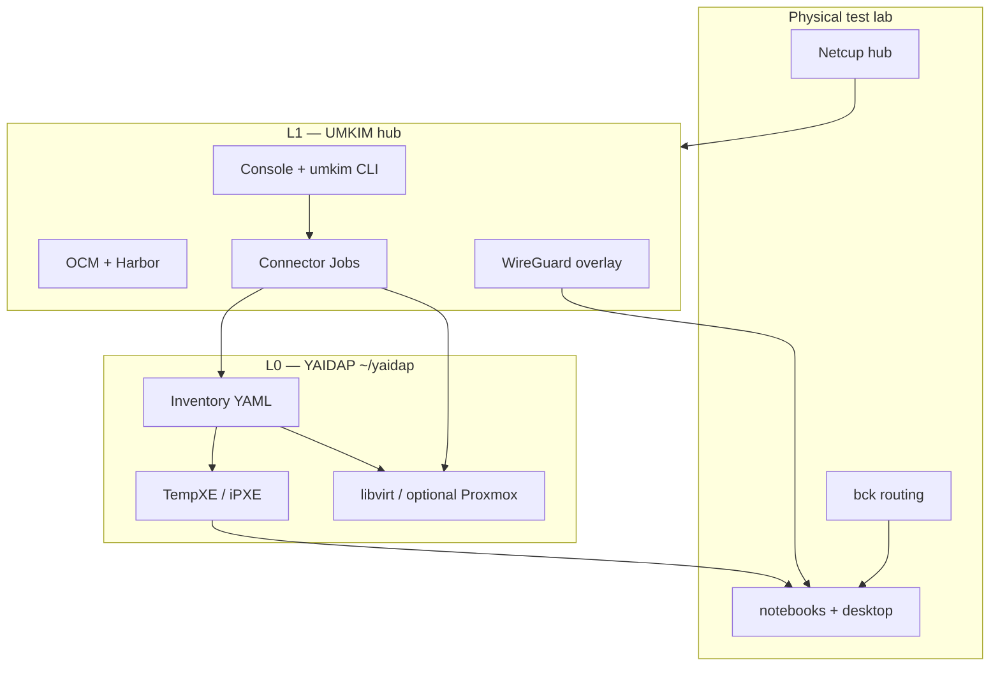
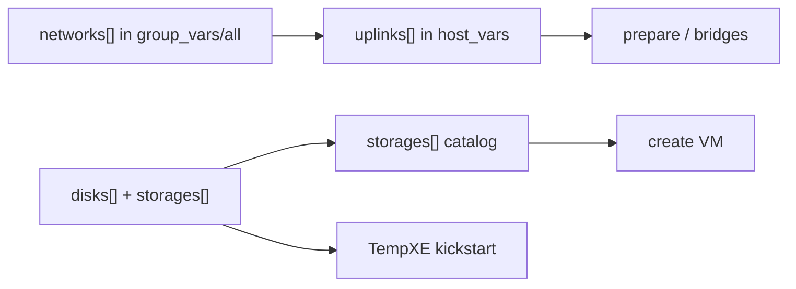
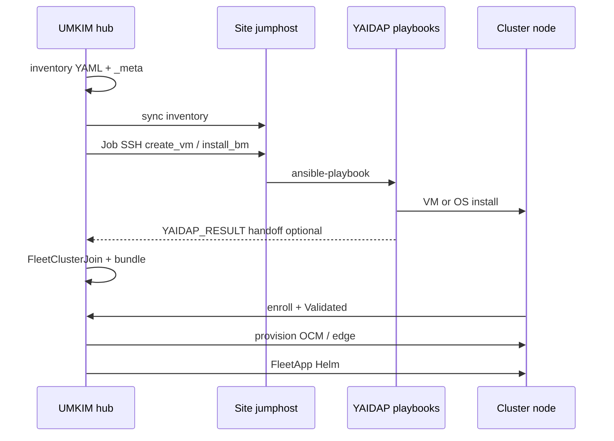

# YAIDAP and UMKIM — two homelab PoCs

Hello to everyone reading this. I want to introduce two proof-of-concept projects I have been building for my lab: **YAIDAP** (**Yet Another Inventory-Driven Ansible Provisioner** — Ansible-first metal and VM provisioning) and **UMKIM** (a hub-centric manager for several independent K3s clusters). They are separate codebases, but UMKIM can call YAIDAP on a site jumphost when you do not want to install nodes by hand.

**Who this is for:** homelab operators who like Ansible more than Terraform, people curious about multi-cluster K3s without a hyperscaler control plane, and anyone willing to read long YAML before clicking “provision.”

Both are experiments, not production platforms. They exist because I wanted to see whether Ansible and a small hub can carry real multi-site Kubernetes operations in a weird home network—not because every problem needs this shape of solution.



> [!WARNING]
> **v0.2 is a proof of concept.** Hub install and cluster delete flows can be destructive. Backup/restore, upgrades, HA, and tenancy are not production-grade. Validate on disposable hardware before trusting anything with data you care about.

---

## YAIDAP

YAIDAP is the older project. It has been rewritten more than once and was originally my learning playground for Ansible, before I sat the older RHCE-style exam. The joke I tell myself is that Ansible is the hammer and everything is a nail. In practice it is an Ansible-driven infrastructure-as-code stack aimed at **building the lab that runs the lab**.

For a long time it also deployed services inside VMs. I narrowed the scope to what I still use every day:

- An **inventory schema** for hosts, networks, and disks
- **Host prepare** and **OS provisioning** (iPXE / kickstart)
- **Libvirt** host preparation and configuration
- **VM create / destroy** on those hypervisors

I never really got into Terraform, and I was curious whether bare-metal and libvirt lifecycle could live entirely in Ansible (whether it *should* is a different question).

The YAIDAP source tree lives at **`~/yaidap`**. The schema contract is in **`~/yaidap/docs/inventory-model.md`** and mirrored in sanitized form under `inventory/example/`. Real lab data is in **`~/yaidap/inventory/lab/`** (network names **`mgmt_nw`** / **`lab_nw`** match my home CIDRs). The step-by-step tutorial uses fictional MACs in **`inventory/demo/`** — see **`~/yaidap/docs/lab-provisioning.md`**.

### Inventory directory layout

Each site or lab is one inventory root (for example `inventory/lab/` or `inventory/example/`):

```text
inventory/<site>/
  group_vars/all/all.yml    # shared networks, storages, TempXE defaults, SSH keys
  group_vars/<group>/       # optional group overrides (e.g. routers + vault)
  hypervisors.yml           # bare-metal / libvirt hypervisor hosts
  guests.yml                # VM guests (libvirt or Proxmox)
  routers.yml               # OpenWrt targets (optional)
  controllers.yml           # Ansible controller / TempXE anchor (optional)
  host_vars/<hostname>.yml  # per-host os, uplinks, disks, vm_location, …
  generated/                # discovery drafts (not hand-edited long-term)
    host_vars/<host>.yml
    host_vars/<host>.notes.json
```

Playbooks are tag-driven under `playbooks/` (`validate-all`, `configure-hypervisors`, `configure-tempxe`, `provision-vms`, `discover-hosts`, …). Almost all behavior is data in the YAML above, not hard-coded host names.



### Shared catalog (`group_vars/all/all.yml`)

These objects are **global names** every host references. Per-host files attach to them via `uplinks` and `disks`.

#### `networks`

Canonical L3 (and default L2) definitions. Uplinks refer to them by `network_name`.

| Field | Meaning |
| --- | --- |
| `network_name` | Unique id used from `uplinks[].networks[]` |
| `cidr` | Network CIDR |
| `gw` | Default gateway |
| `dns` | DNS server |
| `domain` | DNS search suffix |
| `tag` | Default VLAN id; `""` = untagged |
| `physical_network` | Default fabric / trunk name |
| `default_route` | Whether this L3 owns the host default route |
| `dhcp_start` / `dhcp_end` | Optional range hints (TempXE / lab DHCP) |

The same `network_name` can appear on **multiple NICs** with different effective VLAN tags—see uplink overrides below.

Example (from `inventory/example/`; names are fictional):

```yaml
networks:
  - network_name: mgmt_nw
    cidr: 192.168.1.0/24
    gw: 192.168.1.1
    tag: ""
    default_route: true
  - network_name: lab_nw
    cidr: 172.16.10.0/24
    gw: 172.16.10.1
    tag: "10"
    default_route: false
```

#### `storages`

Backend catalog for **hypervisor prepare** and **guest disks**. Filter rows with `os:` (family prefix) and/or `hosts:` so Rocky libvirt and Proxmox can share one file.

| Field | Meaning |
| --- | --- |
| `name` | Id referenced by guest `disks[].storage` |
| `type` | `local`/`dir`, `nfs`, `lvmthin`, `unused`, … (validated per hypervisor OS) |
| `path` | Directory or mountpoint |
| `disk` | Points at a host `disks[].name` for an extra bare-metal disk |
| `server` / `export` | NFS server and export |
| `builtin` | Skip create (e.g. installer-created PVE `local-lvm`) |
| `os` / `hosts` | Scope entry to OS family or hostname |

```yaml
storages:
  - name: local
    type: local
    path: /opt/local
    os: [rocky]
  - name: toshiba
    type: unused          # flip to lvmthin/dir when prepare should use the disk
    disk: disk1
    hosts: [virt03]
```

#### Site-wide defaults (same file)

Alongside `networks` and `storages`, `group_vars/all/all.yml` carries VM defaults (`memory`, `cores`, `domain`), **`libvirt_dir`**, **`tempxe_*`** (server IP, bind interface, discovery flags), **`ssh_pubkey`**, and optional **`cloudinit_*`** for guest create. My lab inventory sets `tempxe_server_ip` and `tempxe_bind_interface` on the controller so TempXE DHCP/TFTP binds on the internal lab bridge, not whatever address Ansible guessed from localhost facts.

### Per-host: `disks` and `uplinks`

**`disks`** describe boot/data layout on bare metal or sizing for VMs:

| Field | Meaning |
| --- | --- |
| `name` | Label (`bootdisk`, `disk1`, …) |
| `disk` | `sda`, `nvme0n1`, or stable `disk/by-id/…` on iron |
| `bootdisk` | OS install target |
| `size` | Size in GiB |
| `storage` | Guest: `storages[].name` on the target hypervisor |
| `format` | VM format (`qcow2`, `raw`) |

Prefer **`disk/by-id/…`** on bare metal so `sda`/`sdb` swaps do not break kickstart after reboot.

**`uplinks`** are the multi-NIC model: each uplink is a physical port or bond carrying one or more attached networks.

| Field | Meaning |
| --- | --- |
| `uplinks[].name` | Uplink id; bridge names derive from it |
| `mac_address` | Stable id; `prepare` resolves kernel ifname from MAC |
| `physical_network` | Fabric when attachment does not override |
| `networks[].network_name` | Must exist in shared `networks` |
| `networks[].tag` | Optional VLAN override for this attachment only |
| `networks[].ip` | Host address on that L3 |
| `networks[].vm_network` | Hypervisor should expose a guest bridge |
| `networks[].zone` / `tcp_open` / … | firewalld when enabled |

Effective VLAN = attachment `tag` if set, else `networks[name].tag`. That is how **one L3 (`lab_nw`) on tagged trunk vs untagged access** works (`inventory/example/host_vars/hv-dual-l1.yml`).

**Bond uplinks:** the example inventory includes **`hv-bond`** — management on one NIC, **`lab_nw`** on an **`active-backup`** bond (`inventory/example/host_vars/hv-bond.yml`). LACP is in the schema but only active-backup was soaked in my lab; see **`~/yaidap/KNOWN_LIMITATIONS.md`**.

Truncated hypervisor example:

```yaml
uplinks:
  - name: n0p0
    physical_network: default_l2
    mac_address: "00:11:22:33:44:55"
    networks:
      - network_name: mgmt_nw
        vm_network: true
        ip: "{{ ansible_host }}"
      - network_name: lab_nw
        vm_network: true
        bridge_name: n0p0_lab_nw
        ip: "172.16.10.2"
```

Guests add **`vm_location`** (hypervisor hostname or `least-utilized`), **`os`**, and often **`hypervisor_uplink`** when the HV exposes the same `network_name` on more than one bridge. **`provisioning_provider: proxmox`** is supported (including nested Proxmox-on-libvirt lab paths and PXE install of PVE 8/9 in the demo walkthrough).

### Ansible groups (root YAML files)

| File | Group | Purpose |
| --- | --- | --- |
| `hypervisors.yml` | `hypervisors` | Iron or nested HV; `ansible_host` is SSH target |
| `guests.yml` | `guests` | Libvirt/Proxmox VMs; includes `vm_location` in host_vars |
| `routers.yml` | `routers` | OpenWrt (`configure-routers.yml`) |
| `controllers.yml` | `controllers` | Machine that runs TempXE / discovery output paths |

Membership is plain Ansible: hostname under `hosts:` plus `host_vars/<hostname>.yml`. When UMKIM syncs inventory, it adds hub-side files (see **Together** below); the YAIDAP-native core is still **hypervisors + guests + shared catalog**.

### How inventory is built (discovery → validate → prepare → create)

Most new bare-metal hosts follow the same pipeline in **`~/yaidap/docs/discovery-to-create.md`**:

1. **Seed** — Put the hostname in `hypervisors.yml` with at least a **MAC** (and `ansible_host` once you know management IP).
2. **Discover** — Either SSH `discover-hosts.yml --tags check_host_details`, or PXE **`tempxe_discovery`** (Rocky Anaconda collector) and `configure-tempxe.yml --tags collect_discovery`. Output lands in **`generated/host_vars/<host>.yml`** plus **`.notes.json`** (hardware detail for humans, GPU PCI ids, NIC chipsets, …).
3. **Edit** — Replace `CHANGE_ME` placeholders: map uplinks to `network_name` entries in `group_vars/all`, set `vm_network`, disk `by-id`, TempXE flags (`install_os`, `pxe` on the right uplink).
4. **Promote** — Copy the draft to **`host_vars/<host>.yml`** (stop treating `generated/` as source of truth).
5. **Validate** — `validate-all.yml --tags validate`.
6. **Prepare** — `configure-hypervisors.yml --tags prepare` (bridges, pools, firewalld optional).
7. **Create guests** — Define `host_vars/my-vm.yml`, add to `guests.yml`, run `provision-vms.yml --tags create`.

PXE **OS install** and **discovery** share TempXE; after a successful install, post-install logic trims kickstart so the next boot chainloads disk. Discovery can run with **`reboot_after_discovery: false`** so a laptop without iLO stays in the live environment until you reboot manually.

**Prepare safety:** bare-metal **`prepare`** rewires bridges and can **strand SSH** (especially dual-NIC bond mid-flight). Read **`~/yaidap/docs/prepare-safety.md`** and first soak with **`configure_firewalld: false`**.

**OpenWrt in inventory:** YAIDAP can model OpenWrt as **`routers`** (DynDNS, reverse proxy, ACME via `configure-routers.yml`) or bootstrap **OpenWrt VM** images with **`tempxe_openwrt_ztp`** (PPPoE, VLAN lab bridge, LAN DHCP off while TempXE serves install DHCP). That is separate from “the router I actually run on **`bck`** hardware”—same schema, different deployment target.

**GPU passthrough:** on the hypervisor, **`gpu_passthrough_host`** (VFIO bind, IOMMU args); on the guest, **`gpu_passthrough`** with PCI ids from **`notes.json`**. One GPU per guest. Lab path: **`~/yaidap/docs/gpu-passthrough.md`**.

### Provisioning flow (TempXE / iPXE)

Many of my nodes are half-notebooks, so provisioning relies on **iPXE**. The internal lab LAN has **no DHCP** in steady state (install-time DHCP comes from the **TempXE Podman container** on the Ansible controller, not from OpenWrt).

When install is armed for a host:

1. TempXE serves DHCP (for the install window), TFTP, and kickstart/iPXE menus.
2. The machine PXE-boots, installs Rocky (or discovery-only, or Proxmox on supported paths).
3. When install is off, DHCP **chainloads local disk** so day-to-day reboots stay fast.

The TempXE role **builds** the container image but the operator still **starts** it (`tempxe_start` / confirm flows)—it is not fully hands-off. Fake bare-metal PXE guests sometimes need manual **`pxe-e1000.rom`** / **`/etc/qemu/bridge.conf`** steps documented in **`KNOWN_LIMITATIONS.md`**.

### YAIDAP limitations (honest short list)

- TempXE container lifecycle is operator-driven; SELinux labeling on ISO trees can bite on Fedora controllers.
- HTTP-ISO NIC coverage and Proxmox dual-NIC edge cases are documented in **`~/yaidap/KNOWN_LIMITATIONS.md`**.
- WireGuard/Authelia on OpenWrt are out of scope for the YAIDAP repo (homelab-only extras elsewhere).
- Kubernetes addons are explicitly **out of scope** — that is UMKIM’s job.

---

## UMKIM (v0.2)

UMKIM is a **management plane for multiple Kubernetes clusters**, not a single giant cluster with workers attached to one control plane.

### What changed from v0.1 to v0.2

Early UMKIM tried to be a simpler “many clusters, one story” stack. **v0.2** reframed around:

- **Per-site exposure** — each `FleetSite` carries its own `ingress[]` and optional **`hubGateway`**, instead of one global “how the world reaches the fleet” knob.
- **Thin hub, fat spoke** — workload clusters are real independent K3s control planes; the hub registers them over WireGuard + OCM but does not run their pods.
- **Console-first lifecycle** — `FleetSite`, `FleetClusterJoin`, bootstrap bundles, and hub Jobs for provision/finalize.
- **Optional YAIDAP connector** — hub-native YAML inventory (`guests`, `bare_metals`, cluster `group_vars`) synced to a jumphost instead of re-encoding disk/VLAN semantics in Fleet CRDs.

### Hub

There is a **management hub**: a K3s cluster on a dedicated host (in my lab, often the external VPS). The hub runs, among other things:

- **Open Cluster Management (OCM)** — register and manage spoke clusters
- **Harbor** — images and Helm charts
- **WireGuard** — overlay between hub and sites
- **Fleet console, fleet-edge routing, and optional ingress-auth** — operator UI, Traefik routes, optional Authelia on **app** URLs (separate from console login)

The **management site** (hub itself) is infrastructure — you do **not** target it with `FleetApp` or treat it as a workload `ManagedCluster`. Create a **non-management** `FleetSite` for the first real cluster.

Spoke clusters are **independent K3s control planes**. After join, the hub applies platform pieces (OLM, cert-manager, spoke ingress helpers). Optional **KubeVirt** is a post-**Ready** platform operation on spokes with KVM, not a FleetApp.

### Operator path (greenfield sketch)

Mirrors [docs/install.md](docs/install.md) in blog form:

1. Bootstrap hub inventory, vault, preflight; install hub K3s stack.
2. Create a WireGuard client; open the **console** over the overlay.
3. Create a **non-management site** and a **FleetClusterJoin** (or define cluster intent in provision inventory with **`autoApply`**).
4. Run **bootstrap** on the first control node; wait for **Validated**, then hub **Provision** until **Ready**.
5. Publish/install a chart with **FleetApp** on the cluster you select.

The **`umkim`** CLI wraps the same API ([docs/components/umkim-cli.md](docs/components/umkim-cli.md)) — e.g. `site provision set`, `site provision yaidap-sync`, `cluster provision`, inventory sync — when you prefer scripts over the UI.

### Sites

A **site** is a logical boundary: a datacenter corner, a room, or “everything behind the same jumphost.” Each site is a `FleetSite`. Sites can define **zero or more ingress methods**:

| Pattern | Idea |
| --- | --- |
| **Port forward** | Public IP ports 80/443 forwarded to a cluster VIP or single-node address |
| **Reverse proxy** | External reverse proxy terminates TLS and routes subdomains to the cluster |
| **Hub gateway** | HTTP(S) published on the hub; hub forwards to spokes over WireGuard |
| **Private** | No fleet-managed WAN path; clusters still join over the overlay |

Clusters bind to a specific ingress row with **`FleetClusterJoin.spec.edge.ingressId`**. Examples: [examples/site-profiles/](examples/site-profiles/).

### Clusters

Every cluster belongs to **exactly one site**. Shapes include **single-node** and **three-node control-plane HA** (plus workers).

The hub issues a **bootstrap bundle** (WireGuard + K3s + enroll). Lifecycle: Pending → ScriptIssued → Enrolled → Validated → Provisioning → **Ready** (**Failed** with retry/recovery documented in [docs/components/fleet-site.md](docs/components/fleet-site.md)).

**Cluster delete defaults to detach:** hub-managed objects go away; spoke K3s and workloads stay unless you opt into full Kubernetes cleanup.

### Workloads: FleetApp and routing

`FleetApp` installs an OCI Helm chart onto **one cluster you name** — no placement engine, no hub-as-target.

| `route.mode` | Behavior | Hub needed for public URL? |
| --- | --- | --- |
| `none` | No fleet-managed route; chart owns ingress | No |
| `hub` | Hub gateway publishes and forwards over WireGuard | Yes (and site needs **`hubGateway`**) |
| `site` | Spoke/site ingress exposes the app (`port_forward`, `reverse_proxy`, …) | No |

Match route mode to site edge (see [docs/components/fleet-apps.md](docs/components/fleet-apps.md)). Console authentication and optional **ingress-auth** on routes are separate concerns.

### Optional hub features (experimental)

- **Fleet LLM** — optional inference profile; needs explicit security review ([docs/components/fleet-llm.md](docs/components/fleet-llm.md)).
- **Backup/restore** — exists but must be validated per app ([docs/backup-restore.md](docs/backup-restore.md)).
- **YAIDAP provisioner** — below and in [docs/components/yaidap-integration.md](docs/components/yaidap-integration.md).

### YAIDAP integration (summary)

Default site provisioner is **`noop`**: bring SSH-ready nodes, run the bootstrap bundle.

With **`provider: yaidap`**, the hub stores inventory in ConfigMap **`fleet-site-{site}-yaidap-inventory`**, runs **`fleet-ansible-runner`** Jobs over SSH to the **jumphost**, and parses optional **`YAIDAP_RESULT=…`** JSON (handoff: `ansible_host`, `ansible_user`, `os_family`) from job logs when integration playbooks set **`yaidap_emit_result: true`**.

---

## Together: from iron to Ready cluster

This is the combined story both repos were written for.

### Hub provision inventory (YAIDAP-enabled site)

| Path | Synced to jumphost? | Role |
| --- | --- | --- |
| `group_vars/all/all.yml` | Yes | `networks`, `storages`, TempXE defaults |
| `hypervisors.yml` | Yes | Placement / discovery targets |
| `guests.yml` | Yes | Libvirt guest index (`ansible_host`, `vm_location`) |
| `bare_metals.yml` | **Hub only** | Bare-metal cluster members; merged into jumphost view on sync |
| `{cluster}.yml` + `group_vars/{cluster}.yml` | Yes | Group membership + `topology`, `autoApply`, VIP / HA fields |
| `host_vars/{guest}.yml` | Yes | Full YAIDAP profile per machine |
| `_meta/status.json` | **Hub only** | Guest phases: Declared → Provisioning → Ready / Failed |
| `controllers.yml`, `routers.yml`, `generated/` | **Jumphost only** | Preserved across sync (TempXE, discovery drafts) |

Edit inventory via console, **`umkim`**, or API → **`POST …/provision/inventory/sync`** → connector actions on the jumphost.

### End-to-end flow

```text
1. Edit hub inventory (guests, host_vars, cluster group_vars)
2. inventory/sync → jumphost ~/…/inventory/<site>/
3. discover / discover_pxe / create_vm / install_bm (YAIDAP playbooks via Job)
4. Guest status Ready; handoff SSH address known
5. cluster-apply → FleetClusterJoin (autoApply or manual)
6. Download bootstrap bundle → bootstrap.sh on control node (via jumphost/SSH)
7. Spoke Validated → umkim cluster provision → OCM + edge finalize → Ready
8. FleetApp chart install + route.mode aligned with site ingress
```



UMKIM owns **intent and enrollment**; YAIDAP owns **kickstart, bridges, libvirt, TempXE semantics**. Do not copy full `networks` / uplink catalogs into Fleet CRDs — they stay in YAML ([docs/components/yaidap-integration.md](docs/components/yaidap-integration.md)).

---

## Test lab

Everything above is tested on a deliberately odd home setup. This section is **my** layout (real IPs), not the topology-neutral design docs in the UMKIM tree.

### Hardware

| Role | Machine | Notes |
| --- | --- | --- |
| **External hub / WAN-facing services** | Netcup VPS | 4 vCPU, 8 GiB RAM; UMKIM hub |
| **Compute node** | Notebook ×2 | Intel i5-8350U, 32 GiB RAM each |
| **Compute + GPU** | Notebook ×1 | Intel i7-7700HQ, 16 GiB RAM, NVIDIA GTX 1050 Ti (4 GiB) |
| **Compute + GPU** | Desktop | Intel i5-8400, 32 GiB RAM, NVIDIA GTX 1650 |
| **Management / routing (`bck`)** | Notebook | OpenWrt; PPPoE passthrough, internal routing, jumphost-style access |

The four compute nodes hang off the same switch as **`bck`**. The VPS reaches the lab over VPN, SSH, port forwards, and WireGuard.

### Network topology

```text
                    ┌─────────────────┐
                    │ Provider router │
                    │ 192.168.1.0/24  │  DHCP on  (= mgmt_nw)
                    └────────┬────────┘
                             │
              ┌──────────────┴──────────────┐
              │  VLAN 10 (on provider LAN) │
              │ 172.16.10.0/24            │  No DHCP  (= lab_nw)
              └──────────────┬──────────────┘
                             │
                    ┌────────┴────────┐
                    │  bck (OpenWrt)  │
                    │  PPPoE passthrough
                    │  USB NIC ───────┼──► unmanaged switch ◄── onboard LAN
                    └─────────────────┘         │
                    unique public IP on USB       ├── 4× compute nodes
                    (separate from other WAN)     └── (iPXE / lab traffic)
```

- **Provider `192.168.1.0/24`:** ISP router DHCP; maps to YAIDAP **`mgmt_nw`** in **`~/yaidap/inventory/lab/group_vars/all/all.yml`**.
- **Internal `172.16.10.0/24`:** routed on **`bck`** VLAN 10; **no steady-state DHCP**; maps to **`lab_nw`**. TempXE on the controller binds here (`tempxe_server_ip`, `tempxe_bind_interface`).
- **`bck` USB NIC** on the same dumb switch (untagged) with a **second public IP**, separate from the primary WAN path.

### Roles of `bck` and inventory

- **`bck` (hardware)** runs **OpenWrt** for routing, PPPoE passthrough, and VLAN 10 — it is the gateway for the internal lab, not something I **`prepare`** with YAIDAP bridge logic on the live router image.
- **YAIDAP** uses **`~/yaidap/inventory/lab/`** with the same **`mgmt_nw` / `lab_nw`** names; playbooks run from a controller that can reach hypervisors (in UMKIM homelab flows, often a **jumphost** SSH target synced from the hub, reachable via **`bck`** port forwards).
- **UMKIM hub** on **Netcup**; a **homelab** `FleetSite` with **`provider: yaidap`** points connector Jobs at that jumphost and inventory path.
- **GPU clusters** on the i7 + 1050 Ti and desktop + 1650; hub **`cluster-gpu-*`** playbooks run after the spoke is **Ready**.

If you reproduce any of this, treat the numbers as one operator’s lab. Greenfield UMKIM steps: [docs/install.md](docs/install.md). UMKIM inventory templates: [examples/inventory/hub-only/](examples/inventory/hub-only/). YAIDAP tutorial with fictional hardware: **`~/yaidap/inventory/demo/`**.

---

## Where to read more

| Project | Starting point |
| --- | --- |
| **UMKIM** (this repo) | [README.md](README.md), [docs/design.md](docs/design.md), [docs/install.md](docs/install.md), [docs/components/umkim-cli.md](docs/components/umkim-cli.md), [docs/components/fleet-apps.md](docs/components/fleet-apps.md) |
| **YAIDAP** (`~/yaidap`) | `README.md`, `docs/inventory-model.md`, `docs/discovery-to-create.md`, `docs/lab-provisioning.md`, `docs/prepare-safety.md`, `KNOWN_LIMITATIONS.md`, `inventory/example/` |
| **YAIDAP + UMKIM connector** | [docs/components/yaidap-integration.md](docs/components/yaidap-integration.md), [docs/components/fleet-site.md](docs/components/fleet-site.md), `~/yaidap/docs/integrations/umkim.md` |

Thanks for reading—both repos are PoCs, and I am still learning in public.
